# BOOKSPACE - APLIKASI PEMESANAN BUKU ONLINE

## 1. Deskripsi Project
BookSpace merupakan aplikasi website sederhana untuk pemesanan buku secara online. Project ini dibuat untuk memenuhi tugas Ujian Tengah Semester (UTS) mata kuliah Pemrograman Web 1.

Aplikasi ini menggunakan HTML, CSS, dan JavaScript dengan data dummy tanpa menggunakan database.

## 2. Tujuan Project
- Membuat struktur HTML yang semantik.
- Mengatur tampilan website menggunakan CSS.
- Menerapkan JavaScript untuk manipulasi DOM.
- Membuat validasi form dan alert.
- Membuat website yang interaktif.

## 3. Teknologi yang Digunakan
- HTML
- CSS
- JavaScript
- Visual Studio Code
- Live Server

## 4. Struktur Folder

```text
BookSpace/
│
├── login.html
├── dashboard.html
├── stok.html
├── checkout.html
├── tracking.html
├── README.md
│
├── css/
│   └── style.css
│
├── js/
│   ├── script.js
│   ├── data.js
│   └── stok.js
│
├── img/
│   ├── buku1.jpg
│   ├── buku2.jpg
│   ├── buku3.jpg
│   ├── buku4.jpg
│   └── buku5.jpg
│
├── assets/
│
└── screenshot/
    ├── halamanlogin1.png
    ├── halamanlogin2.png
    ├── halamanlogin3.png
    ├── halamanlogin4.png
    ├── halamanpemesanan1.png
    ├── halamanpemesanan2.png
    ├── halamanpemesanan3.png
    ├── halamanpemesanan4.png
    ├── halamanpemesanan5.png
    ├── halamanpemesanan6.png
    ├── katalogbuku1.png
    ├── katalogbuku2.png
    ├── katalogbuku3.png
    ├── menutama.png
    ├── stokbuku1.png
    ├── stokbuku2.png
    ├── tracking1.png
    └── tracking2.png
```

## 5. Fitur Website

### A. Halaman Login
- Login menggunakan email dan password.
- Validasi akun.
- Alert jika login salah.
- Modal lupa password.
- Modal pendaftaran akun.

Akun Login:
- Email: admin@bookspace.com
- Password: 123456

### B. Dashboard Menu
- Menu Informasi Stok/Katalog.
- Menu Tracking Pengiriman.
- Menu Laporan Pemesanan.
- Menu History Transaksi.
- Greeting berdasarkan waktu lokal.

### C. Informasi Stok/Katalog
- Menampilkan data buku.
- Menampilkan gambar sampul buku.
- Menampilkan judul dan penulis.
- Menampilkan kategori buku.
- Menampilkan harga dan stok.
- Menambahkan data buku menggunakan JavaScript DOM.
- Validasi input data buku.

### D. Halaman Pemesanan
- Menampilkan informasi pemesanan.
- Mengisi data pemesan.
- Mengisi informasi pembayaran.
- Mengelola data pesanan.

### E. Tracking Pengiriman
- Input nomor Delivery Order.
- Mencari data pengiriman.
- Menampilkan nama pemesan.
- Menampilkan status pengiriman.
- Menampilkan detail ekspedisi.
- Menampilkan tanggal pengiriman.
- Menampilkan jenis paket dan total pembayaran.

## 6. Implementasi JavaScript
JavaScript digunakan untuk membuat website lebih interaktif, antara lain:
1. Validasi login.
2. Menampilkan alert.
3. Membuka dan menutup modal.
4. Menampilkan greeting.
5. Menampilkan data katalog buku.
6. Menambahkan data buku baru.
7. Validasi form.
8. Menampilkan informasi pengiriman.

## 7. Dokumentasi Screenshot

### A. Halaman Login

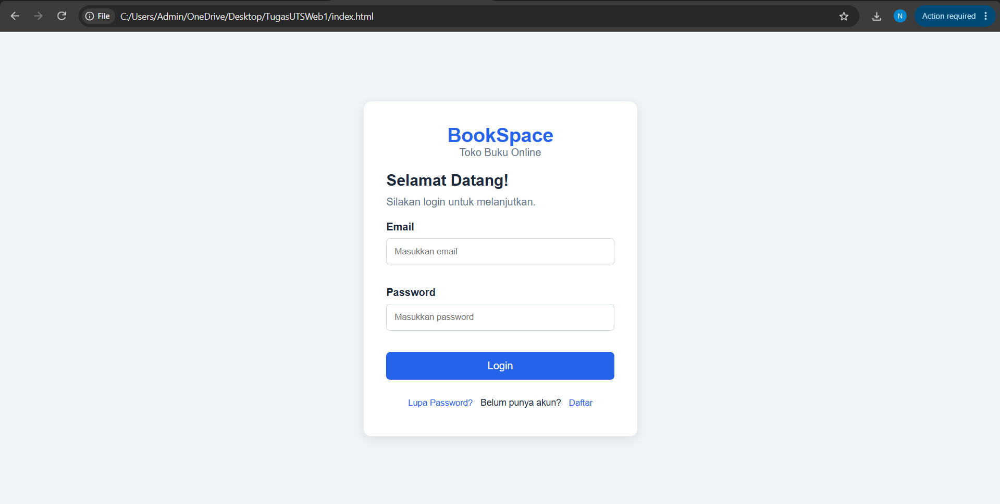

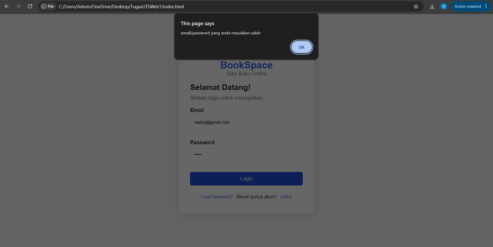

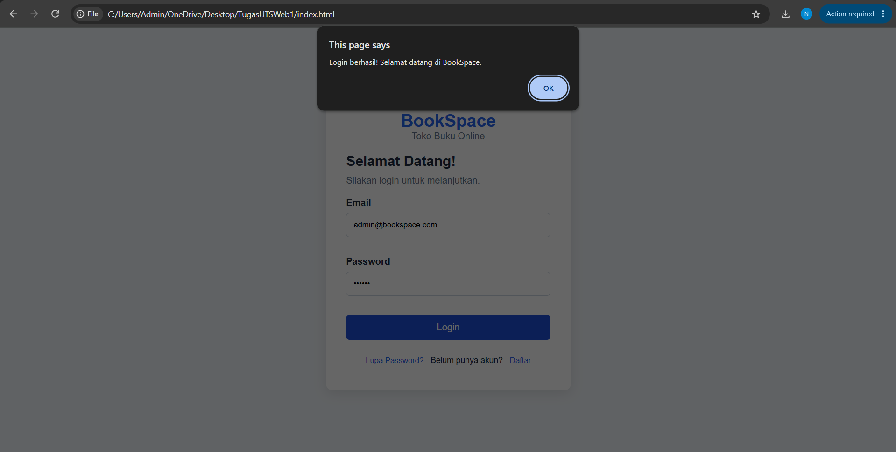

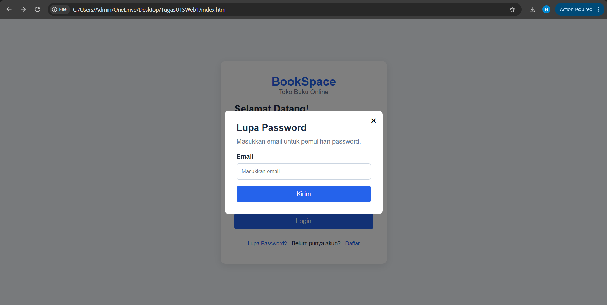

### B. Halaman Pemesanan

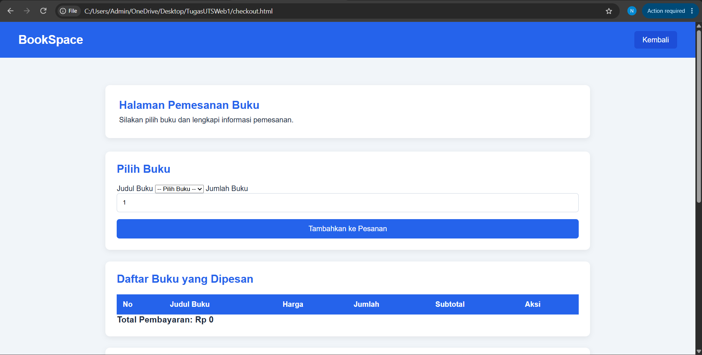

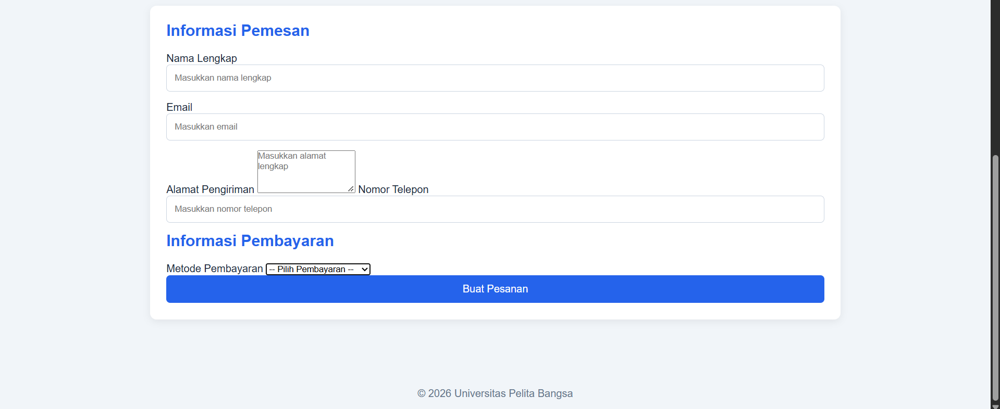

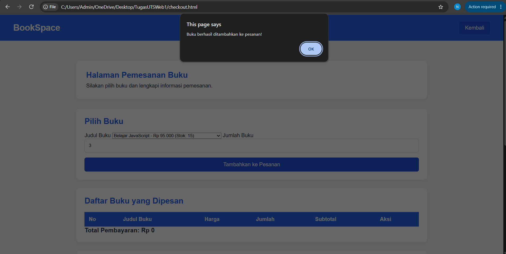

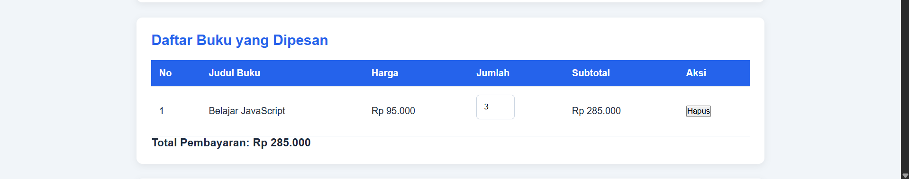

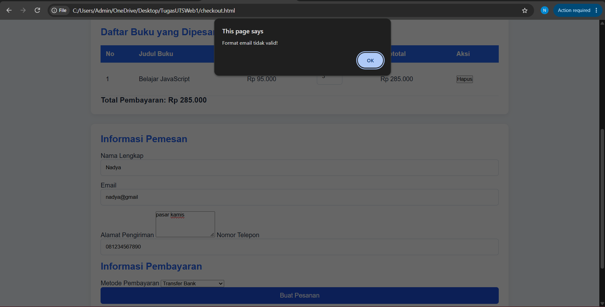

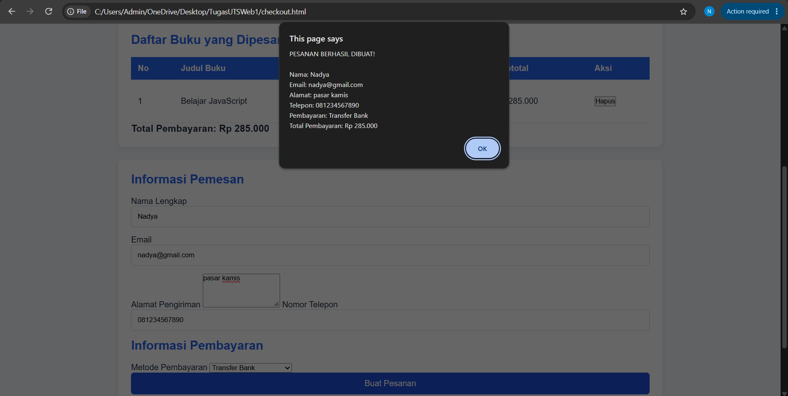

### C. Katalog Buku

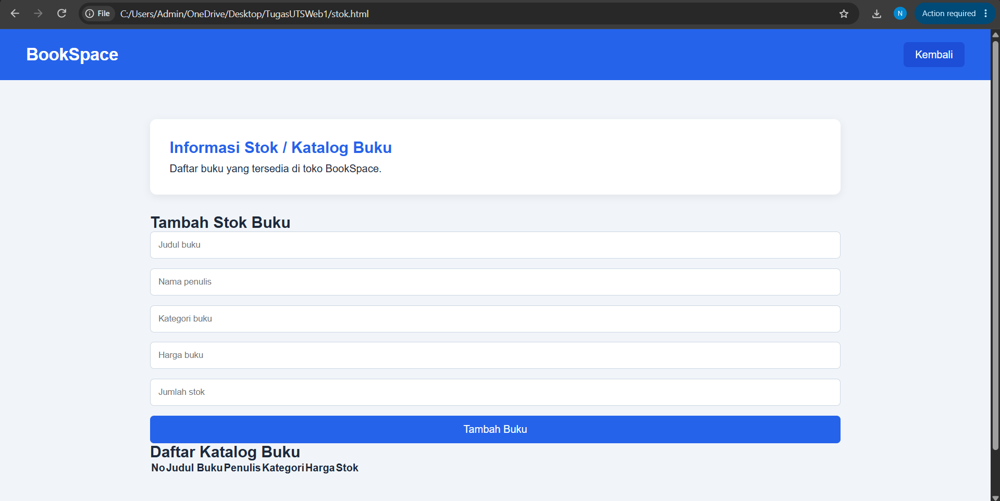

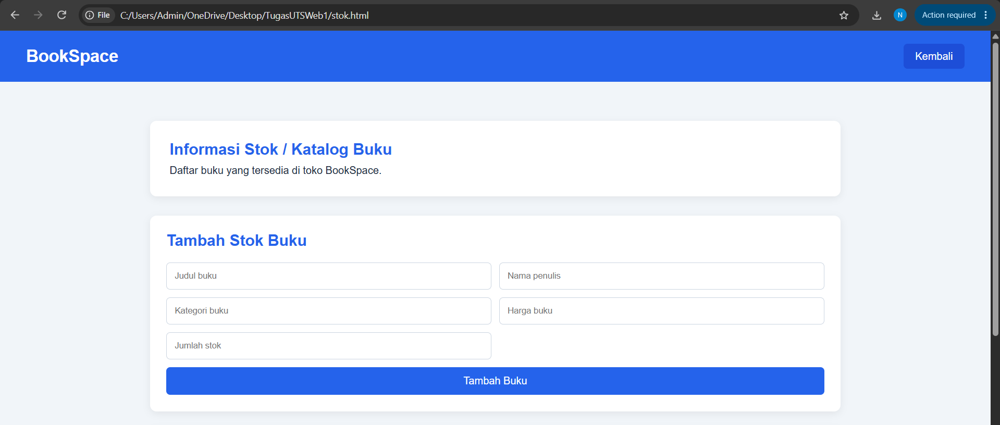

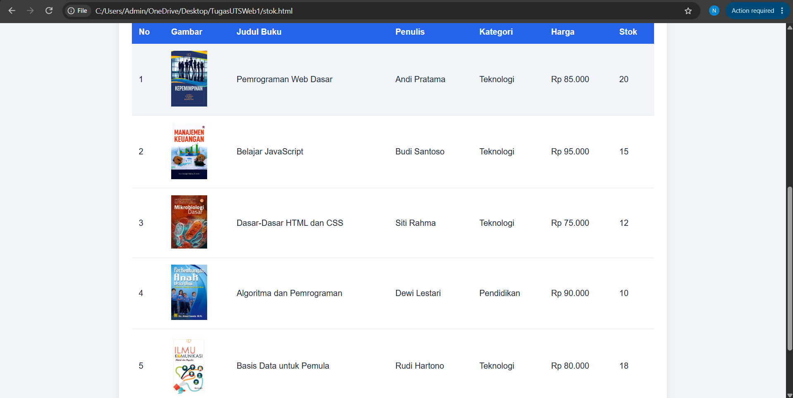

### D. Menu Utama


### E. Informasi Stok Buku

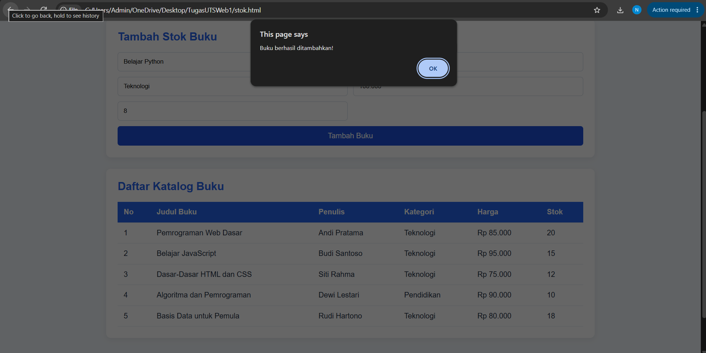

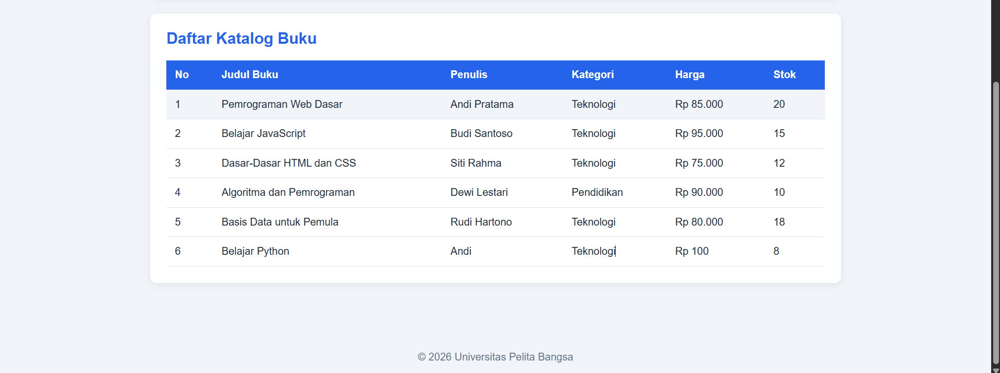

### F. Tracking Pengiriman

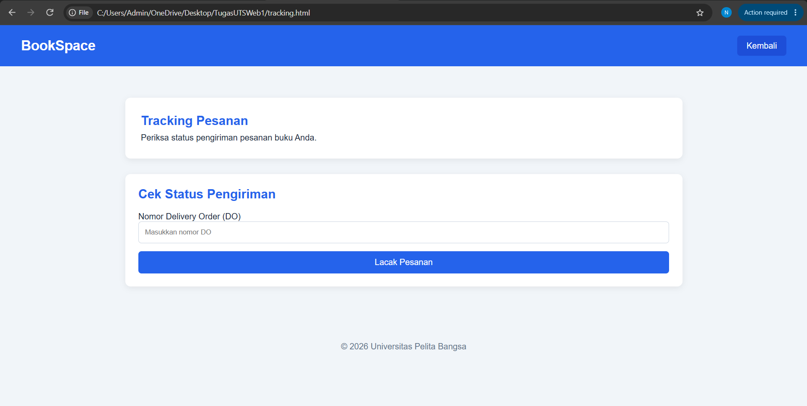

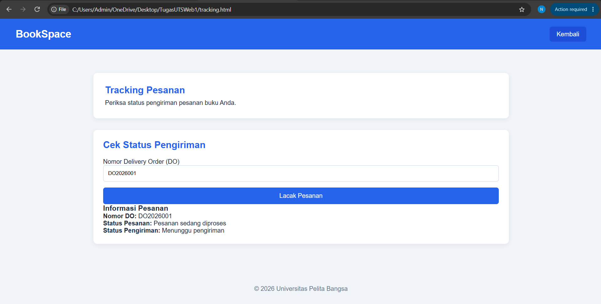

## 8. Cara Menjalankan Website
1. Buka folder BookSpace di Visual Studio Code.
2. Pastikan semua file sudah tersedia.
3. Buka file login.html.
4. Klik kanan dan pilih Open with Live Server.
5. Website akan terbuka di browser.
6. Masukkan akun demo untuk login.

## 9. Kesimpulan
Melalui pembuatan aplikasi BookSpace, mahasiswa dapat menerapkan HTML untuk membuat struktur halaman, CSS untuk mengatur tampilan, dan JavaScript untuk membuat fitur interaktif.

Project ini membantu memahami manipulasi DOM, penggunaan data dummy, validasi form, serta pembuatan aplikasi website sederhana berbasis Front-End.

---

**Project:** BookSpace  
**Nama:** NADYA NISAQILAH PUTRI BUDIMAN
**Nim:** 312510191
**Mata Kuliah:** Pemrograman Web 1  
**Tugas:** Ujian Tengah Semester (UTS)